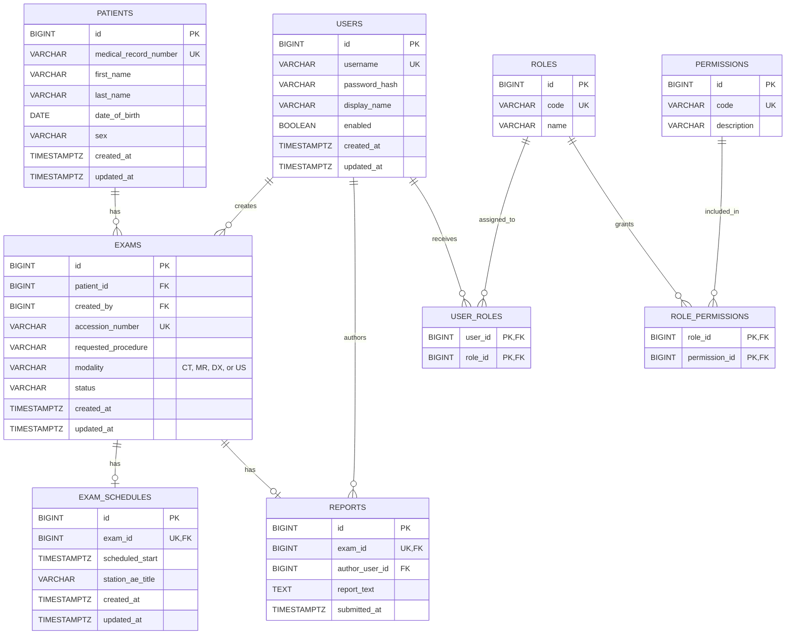

# Database Entity Relationship Diagram

Status: conceptual documentation of the **Implemented** Flyway schema. The
physical schema source of truth is
[`../backend/src/main/resources/db/migration/`](../backend/src/main/resources/db/migration/).

`EXAMS.modality` is restricted by the named `chk_exams_modality` constraint to
`CT`, `MR`, `DX`, or `US` so the database matches the backend `Modality` enum.
`EXAM_SCHEDULES.exam_id` and `REPORTS.exam_id` are unique, enforcing at most one
current schedule and one submitted report per exam. The backend domain already
validates lifecycle transitions; complete API-level role enforcement remains a
**Target**.
